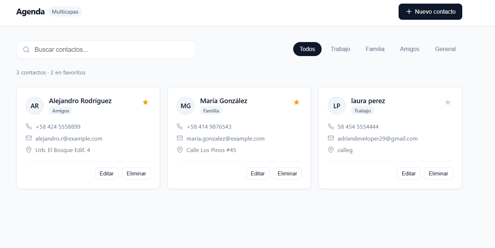
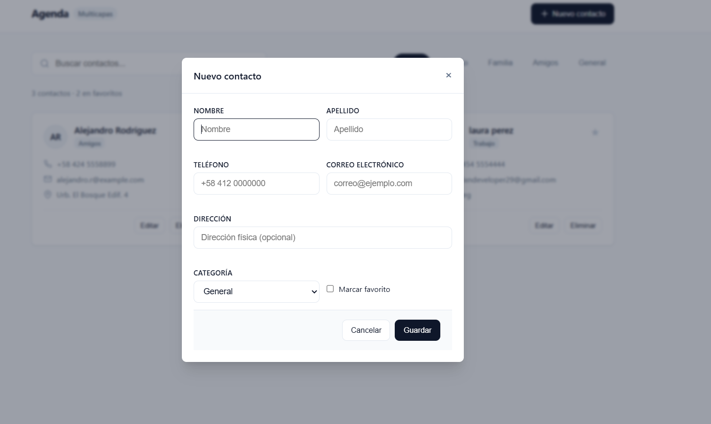

# Multiagenda Tarea 3

**Estudiante:** Adrian Francisco Brito Nelkitts  
**Matrícula:** 2025-1150  
**Materia:** Programación Web  
**Repositorio:** [https://github.com/Adrixn23/agendaMulticapas](https://github.com/Adrixn23/agendaMulticapas)

---

## Capturas de Pantalla

### Vista Principal de Contactos


### Modal de Registro y Edición


---

## Arquitectura Multicapa

* **`Agenda.Domain`**: Entidades (`Contacto`), DTOs con validaciones de atributos e interfaces (`IContactoRepository`, `IContactoService`).
* **`Agenda.Data`**: Repositorio de acceso a datos con persistencia JSON asíncrona y control de concurrencia (`SemaphoreSlim`).
* **`Agenda.Business`**: Lógica de negocio (reglas de no duplicidad de correo/teléfono, filtros y normalización).
* **`Agenda.Api`**: Controladores RESTful (`ContactosController`), inyección de dependencias y configuración de CORS.
* **`frontend`**: Interfaz web moderna y minimalista que consume la API mediante `fetch` y Promesas de JavaScript.

---

## Instrucciones de Ejecución

### 1. Iniciar la API Backend
```bash
cd backend/Agenda.Api
dotnet run
```
La API queda escuchando en `http://localhost:5000`.

### 2. Abrir la Aplicación Web
Accede desde tu navegador a `http://localhost:5000` o abre directamente el archivo `frontend/index.html`.

---

## Endpoints de la API (`/api/contactos`)

* `GET /api/contactos` - Obtener lista de contactos (soporta filtros `busqueda` y `categoria`).
* `GET /api/contactos/{id}` - Obtener contacto por Id.
* `POST /api/contactos` - Crear nuevo contacto.
* `PUT /api/contactos/{id}` - Actualizar contacto.
* `DELETE /api/contactos/{id}` - Eliminar contacto.
* `PATCH /api/contactos/{id}/favorito` - Alternar estado de favorito.

---

## Buenas Prácticas Aplicadas

* **Principios SOLID**: Responsabilidad única por capa, inversión de dependencias con interfaces y desacoplamiento de la persistencia.
* **CORS**: Habilitado para permitir peticiones entre el cliente web y el backend.
* **Promesas en JavaScript**: Manejo asíncrono con `Promise`, `fetch`, `.then()` y `.catch()`.
